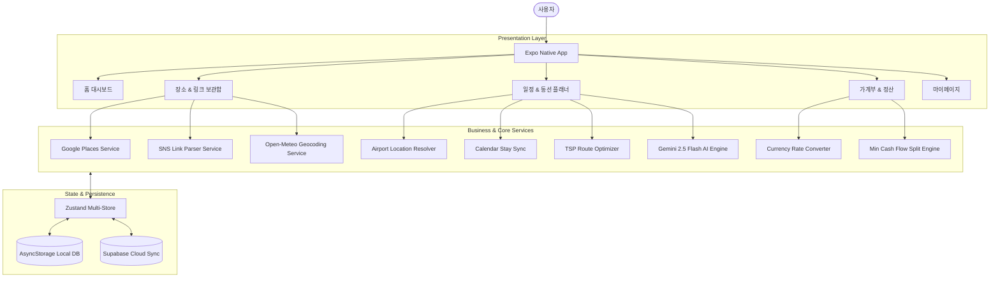

# ✈️ 핀치 (Pinchi) - Pinch to Plan!

<p align="center">
  
</p>

<p align="center">
  <strong>"흩어진 SNS 핫플을 핀치(Pinch)하여 내 여행으로 쏙!"</strong><br />
  AI 기반 올인원 스마트 여행 플래닝 & 실시간 1/N 정산 플랫폼
</p>

<p align="center">
  
  
  
  
  
  
</p>

---

## 📖 목차 (Table of Contents)
1. [프로젝트 소개 (Overview)](#-프로젝트-소개-overview)
2. [핵심 기능 (Key Features)](#-핵심-기능-key-features)
   - [1. 스마트 핫플 수집 & 보관함 (Pinch Pocket)](#1-스마트-핫플-수집--보관함-pinch-pocket)
   - [2. 구글 지도 실시간 데이터 연동 (Google Places)](#2-구글-지도-실시간-데이터-연동-google-places)
   - [3. 지능형 일정 & 동선 플래너 (Planner Engine)](#3-지능형-일정--동선-플래너-planner-engine)
   - [4. 전세계 도시 검색 & Gemini AI 맞춤 코스 기획](#4-전세계-도시-검색--gemini-ai-맞춤-코스-기획)
   - [5. 여행 가계부 & 1/N 스마트 정산 (Smart Wallet)](#5-여행-가계부--1n-스마트-정산-smart-wallet)
3. [기술 스택 (Tech Stack)](#-기술-스택-tech-stack)
4. [시스템 아키텍처 (System Architecture)](#-시스템-아키텍처-system-architecture)
5. [프로젝트 구조 (Directory Structure)](#-프로젝트-구조-directory-structure)
6. [시작하기 (Getting Started)](#-시작하기-getting-started)
   - [사전 요구사항](#사전-요구사항)
   - [설치 및 환경 변수 설정](#설치-및-환경-변수-설정)
   - [로컬 실행](#로컬-실행)
7. [품질 검증 및 테스트 (Testing & QA)](#-품질-검증-및-테스트-testing--qa)
8. [모바일 APK 빌드 가이드 (EAS Build)](#-모바일-apk-빌드-가이드-eas-build)

---

## 🌟 프로젝트 소개 (Overview)

여행을 준비할 때, 우리는 보통 다음과 같은 복잡하고 번거로운 과정을 겪습니다:
- **파편화된 정보**: 인스타그램 릴스, 유튜브 숏츠, 블로그에 저장해둔 장소들을 엑셀이나 메모장에 일일이 옮겨 적어야 함.
- **동선 파악의 어려움**: 저장해둔 핫플들이 서로 얼마나 떨어져 있는지 확인하기 위해 지도 앱을 켜고 매번 검색해야 함.
- **실제 여행 변수의 괴리**: 심야 비행기, 익일 새벽 도착, 입국 수속 버퍼, 호텔 연박 숙박 등이 일정표에 자연스럽게 반영되지 않아 첫날부터 일정이 꼬임.
- **정산의 피로**: 현지 통화와 원화 환산, 친구들과의 1/N 정산이 헷갈려 여행 중 스트레스를 유발함.

**핀치(Pinchi)**는 링크 하나만 핀치하면 **AI 추출부터 최적 동선 플래닝, 항공/숙소 스케줄 자동 연동, 실시간 1/N 가계부 환율 정산**까지 여행의 모든 단계를 원스톱으로 해결하는 크로스 플랫폼 스마트 여행 일정 관리 앱입니다.

---

## 🚀 핵심 기능 (Key Features)

### 1. 스마트 핫플 수집 & 보관함 (Pinch Pocket)
- **클립보드 자동 감지 (Smart Clipboard Listener)**: 인스타그램 릴스, 유튜브 숏츠, 네이버 블로그/지도 링크를 복사하고 앱을 열면 즉시 장소를 추출하여 보관함에 담을 수 있는 팝업 제공.
- **다중 장소 추출 모달 (`LinkPlacesModal`)**: 하나의 영상/게시글에 여러 장소가 포함되어 있어도 원하는 장소만 쏙 골라 내 여행 일정에 주입.
- **여행별 엄격한 격리 관리**: 현재 활성화된 여행(`activeTripId`)에 맞춰 장소 및 링크가 독립 보관되어 다른 여행과 섞이지 않음.

### 2. 구글 지도 실시간 데이터 연동 (Google Places)
- **실제 구글맵 정보 실시간 로드**: 장소 상세 화면에서 구글맵 공식 장소 설명(`editorial_summary`), 실시간 별점 평점(예: `⭐ 4.8 / 5.0`), 총 리뷰 개수를 완벽 연동.
- **사진 갤러리 썸네일 스트립**: 구글맵에 등록된 고해상도 장소 사진들을 가로 스크롤로 탐색하고 탭하여 즉시 메인 히어로 뷰로 전환.
- **방문객 생생 후기 (Local Guide Reviews)**: 실제 방문자의 프로필, 방문 시기, 별점, 생생한 후기 카드 렌더링 및 `[구글맵에서 리뷰 전체보기 ↗]` 딥링크 지원.
- **무오차 명칭 기반 검색**: 좌표 오차 문제를 해결하기 위해 GPS 좌표 대신 **'장소 이름 + 주소'**로 구글 지도 길찾기를 실행하여 100% 실제 위치로 안내.

### 3. 지능형 일정 & 동선 플래너 (Planner Engine)
- **실제 공항 좌표 매핑 & 항공권 연동 (`airportService`)**:
  - 인천(ICN), 김포(GMP), 나리타(NRT), 괌(GUM), 다낭(DAD) 등 전세계 30여 개 주요 공항의 실제 IATA 코드 및 위경도 좌표 보유.
  - 심야 비행 및 익일 도착(+1일) 자동 감지 (밤 23:00 출발 후 다음 날 04:00 도착 시 DAY 2 일정으로 자동 배치).
  - 입국 수속 버퍼(+60분~+150분) 설정 시 도착일의 일정 시작 시간을 지능적으로 자동 조정.
- **숙소 등록 & 캘린더 연박 연동 (`LodgingEngine`)**:
  - 호텔/리조트 검색 시 주소와 좌표를 자동 입력하며, 캘린더 범위 선택(`CalendarRangePicker`)으로 묵는 기간(예: DAY 1 ~ DAY 3) 동안 매일 일정의 시작점/숙소 스팟으로 자동 연동.
- **외판원 순회(TSP) 알고리즘 기반 최단 동선 최적화 (`routeOptimizer.ts`)**:
  - 하루에 여러 장소를 방문할 때 이동 거리를 최소화하는 순서로 일정을 1초 만에 자동 재정렬.
- **인터랙티브 맵 시각화 (`PlannerMapView`)**:
  - Leaflet 기반 고해상도 지도 위에 방문 순서 번호 핀(1, 2, 3...), 현재 활성 핀 하이라이트, 실시간 경로 폴리라인(Polyline) 렌더링.

### 4. 전세계 도시 검색 & Gemini AI 맞춤 코스 기획
- **Open-Meteo Geocoding 기반 전세계 도시 검색**: 완전 무료로 전세계 모든 도시, 군, 구, 휴양지를 실시간 검색하고 지도 중심 좌표를 자동 포커싱.
- **Gemini 2.5 Flash 기반 여행 코스 생성 (`PStyleCourseModal`)**:
  - **5대 여행 스타일**: 🌿 여유&힐링, 📸 핵심 랜드마크, 🌊 자연&풍경, 🍴 미식&맛집, 🛍️ 쇼핑&트렌드
  - **3대 일정 페이스**: ☕ 느긋하게 (하루 2~3곳), 🏃 알차게 (하루 3~4곳), 🚀 빡세게 (하루 4~5곳)
  - 선택한 도시의 실제 핫플을 찾아 인접 구역별 동선, 이동/체류 시간, 방문 팁을 담은 맞춤 코스를 3초 만에 생성.

### 5. 여행 가계부 & 1/N 스마트 정산 (Smart Wallet)
- **실시간 환율 변환**: KRW, JPY, USD, EUR, VND 등 현지 통화로 입력 시 당일 환율을 적용하여 원화 금액을 자동 계산.
- **자유로운 커스텀 예산**: 항공, 숙박, 식비 등 기본 항목 외에 여행자가 원하는 맞춤 예산 항목 자유롭게 추가.
- **최소 거래 횟수 정산 알고리즘 (Min Cash Flow Settlement)**:
  - 여행에 참여한 멤버별 결제액을 분석하여 복잡한 송금 관계를 최소 송금 경로로 압축(A가 B에게 얼마 송금)하고 메신저 공유 텍스트 생성.

---

## 🛠️ 기술 스택 (Tech Stack)

| 분류 | 기술 스택 | 설명 |
|---|---|---|
| **Core Framework** | React Native 0.86, Expo SDK 57 | 최신 React 19 및 New Architecture 기반 크로스 플랫폼 모바일 앱 |
| **Routing** | Expo Router v4 | 파일 시스템 기반 타입 안전한 탭 & 모달 라우팅 |
| **Language** | TypeScript 6.0 | 엄격한 타입 안정성 및 자동 완성 지원 |
| **Styling** | NativeWind v4, TailwindCSS 3.4 | 유틸리티 기반 고성능 네이티브 스타일링 |
| **Icons & UI** | Lucide React Native | 일관되고 세련된 모던 아이콘 시스템 |
| **State Management** | Zustand v5, AsyncStorage | 오프라인 지속성 및 경량 글로벌 상태 관리 |
| **Map & Geospatial** | Leaflet, React Native WebView | 하버사인 거리 계산 및 외판원 순회(TSP) 알고리즘 |
| **AI & APIs** | Google Gemini 2.5 Flash, Google Places API | 실시간 장소 데이터, 구글맵 후기/평점/사진 및 AI 코스 추천 |
| **Backend / Auth** | Supabase JS v2 | 사용자 계정 인증 및 클라우드 동기화 |
| **Build & Deploy** | EAS Build (Expo Application Services) | Android APK / iOS 빌드 파이프라인 |

---

## 🏗️ 시스템 아키텍처 (System Architecture)



---

## 📁 프로젝트 구조 (Directory Structure)

```
Pinchi/
├── app/                        # Expo Router 기반 앱 화면 라우팅
│   ├── (tabs)/
│   │   ├── _layout.tsx         # 바텀 탭 네비게이션
│   │   ├── index.tsx           # 1. 홈 대시보드
│   │   ├── places.tsx          # 2. 장소 & 링크 보관함
│   │   ├── planner.tsx         # 3. 일정 & 동선 플래너
│   │   ├── wallet.tsx          # 4. 여행 가계부 & 1/N 정산
│   │   └── profile.tsx         # 5. 마이페이지 & 계정 관리
│   ├── _layout.tsx             # 루트 네비게이션 프로바이더
│   └── +not-found.tsx          # 404 폴백
├── src/
│   ├── components/             # 모듈화된 UI 컴포넌트
│   │   ├── auth/               # Supabase 로그인/회원가입 모달
│   │   ├── common/             # Button, Header, CalendarRangePicker 등
│   │   ├── places/             # PlaceDetailModal, PlaceSearchModal, LinkPlacesModal
│   │   ├── planner/            # FlightModal, LodgingModal, PlannerMapView, AddSpotModal
│   │   ├── trip/               # CreateTripModal, PStyleCourseModal, TripSwitcherModal
│   │   └── wallet/             # CategoryBudgetModal, SettleModal
│   ├── services/               # 외부 API 및 코어 비즈니스 로직
│   │   ├── airportService.ts   # 전세계 주요 공항 IATA 코드 및 좌표 리졸버
│   │   ├── googlePlacesService.ts # 구글맵 설명, 별점, 사진, 리뷰 실시간 수집
│   │   ├── geminiService.ts    # Gemini 2.5 Flash 여행 일정 생성
│   │   ├── destinationSearchService.ts # 전세계 도시 지오코딩 검색
│   │   ├── itineraryGeneratorService.ts # MBTI P형 맞춤 추천 엔진
│   │   └── parserService.ts    # SNS 릴스/쇼츠/블로그 링크 파서
│   ├── store/                  # Zustand 상태 저장소
│   │   ├── useTripStore.ts     # 여행, 일정 스케줄, 항공/숙소 연동
│   │   ├── usePlaceStore.ts    # 장소 보관함
│   │   ├── useSavedLinkStore.ts# 링크 보관함
│   │   ├── useWalletStore.ts   # 예산, 지출, 환율, 정산
│   │   └── useAuthStore.ts     # 사용자 계정 프로필
│   ├── utils/                  # 유틸리티 함수
│   │   ├── geoUtils.ts         # 하버사인 거리 계산 및 TSP 최적화 알고리즘
│   │   ├── mapUtils.ts         # 구글 지도 길찾기 딥링크 연동
│   │   └── settlementUtils.ts  # 최소 거래 횟수 정산 알고리즘
│   └── types/                  # 공통 TypeScript 타입 정의
├── __tests__/                  # 단위 및 통합 테스트 스위트
├── docs/                       # 상세 제품 기획서 및 PRD
└── eas.json                    # Expo Application Services 빌드 설정
```

---

## ⚡ 시작하기 (Getting Started)

### 사전 요구사항
- [Node.js](https://nodejs.org/) v18.0.0 이상
- [npm](https://www.npmjs.com/) 또는 yarn
- 스마트폰에 [Expo Go](https://expo.dev/go) 앱 설치 (Android / iOS)

### 설치 및 환경 변수 설정

1. **저장소 클론 및 패키지 설치**
```bash
git clone https://github.com/seohaneul/pinch.git
cd pinch
npm install
```

2. **환경 변수 파일 생성 (`.env`)**
프로젝트 루트 디렉토리에 `.env` 파일을 생성하고 다음 API 키를 설정합니다:
```env
# Gemini AI 맞춤 코스 추천 및 구글 Grounding 연동
EXPO_PUBLIC_GEMINI_API_KEY=your_gemini_api_key_here

# (선택) Google Places 공식 API 키
EXPO_PUBLIC_GOOGLE_MAPS_API_KEY=your_google_maps_api_key_here

# (선택) Supabase 클라우드 동기화 연동
EXPO_PUBLIC_SUPABASE_URL=your_supabase_url_here
EXPO_PUBLIC_SUPABASE_ANON_KEY=your_supabase_anon_key_here
```

### 로컬 실행

- **Expo 개발 서버 시작**:
  ```bash
  npx expo start
  ```
- **실행 모드별 단축키**:
  - 터미널에 나타난 QR 코드를 스마트폰 카메라(iOS) 또는 **Expo Go**(Android) 앱으로 스캔하면 모바일 기기에서 즉시 실행됩니다.
  - `w`: 웹 브라우저에서 실행
  - `a`: 안드로이드 에뮬레이터에서 실행
  - `i`: iOS 시뮬레이터에서 실행

---

## 🧪 품질 검증 및 테스트 (Testing & QA)

본 프로젝트는 핵심 비즈니스 로직(TSP 최적화, 정산 알고리즘, 환율 계산, 스케줄 타임라인, 중복 방지)에 대해 총 50개의 단위/통합 테스트를 구축하여 안정성을 보장합니다.

```bash
# 50개 자동화 단위 테스트 실행
npm test
```

```bash
# TypeScript 타입 검사 (오류 0개 검증)
npx tsc --noEmit
```

---

## 📱 모바일 APK 빌드 가이드 (EAS Build)

실제 안드로이드 스마트폰에 설치 가능한 `.apk` 독립 실행형 파일을 빌드하려면 [EAS CLI](https://docs.expo.dev/build/setup/)를 사용합니다.

```bash
# 1. EAS CLI 설치 및 Expo 로그인
npm install -g eas-cli
eas login

# 2. Android APK 프리뷰 빌드 트리거
eas build -p android --profile preview
```
빌드가 완료되면 터미널에 표시되는 다운로드 URL 또는 QR 코드를 통해 스마트폰에 APK를 직접 다운로드하여 설치할 수 있습니다.

---

## 📄 라이선스 (License)

This project is licensed under the MIT License - see the LICENSE file for details.
