# ✈️ 핀치 (Pinchi) 서비스 기획서 & PRD
> **"링크를 핀치(Pinch)하여 내 여행으로 쏙! 올인원 스마트 여행 플래너"**  
> **버전**: v1.0  
> **작성일자**: 2026년 10월  
> **대상 플랫폼**: iOS, Android, Web (Cross-Platform Mobile App)  
> **기술 스택**: React Native (Expo SDK 57), TypeScript, NativeWind, Zustand, Leaflet/WebView  

---

## 1. 프로젝트 개요 (Executive Summary)

### 1.1 서비스 정의
**핀치(Pinchi)**는 흩어져 있는 SNS 핫플 수집부터 최적 동선 플래닝, 항공/숙소 스케줄 자동 연동, 실시간 1/N 가계부 및 환율 정산까지 여행의 모든 단계를 하나로 해결하는 **올인원 스마트 여행 일정 플랫폼**입니다.

### 1.2 기획 배경 (Problem Definition)
1. **여행 정보의 파편화 (Fragmented Workflow)**
   - 여행자들은 인스타그램 릴스, 유튜브 숏츠, 네이버 블로그 등에서 장소를 저장하지만, 정작 여행 일정을 짤 때는 엑셀/노션/구글 맵/메모장을 오가며 수작업으로 옮겨 적어야 하는 번거로움이 있습니다.
2. **동선 및 위치 파악의 비효율 (Geographic Complexity)**
   - SNS에서 본 핫플이 도시의 어느 쪽에 있는지, 하루 일정에 묶을 수 있는지 확인하기 위해 매번 지도 앱을 켜서 검색해야 합니다.
3. **항공/숙소 등 실제 여행 변수의 괴리 (Flight & Lodging Friction)**
   - 심야 비행기, 익일 새벽 도착, 입국 수속 버퍼 시간, 여러 날 연속 묵는 연박 숙소 등 실제 여행의 필수 조건들이 일정표에 자연스럽게 녹아들지 못해 첫날 일정이 꼬이는 문제가 빈번합니다.
4. **비용 관리 및 정산의 피로 (Expense & Split Inefficiency)**
   - 현지 통화(엔화, 달러, 동 등)와 원화 환산, 예산 초과 여부 확인, 친구들과의 1/N 정산 과정이 복잡하여 여행 중 스트레스를 유발합니다.

### 1.3 핵심 해결 방안 (Solution & Value Proposition)
- **🤏 Pinch (스마트 핫플 수집)**: 링크만 복사하면 AI가 장소명, 주소, 좌표를 자동 추출하고, 이름 검색으로도 즉시 보관함에 저장.
- **🗺️ Plan (지능형 일정 & 동선 플래너)**: 실제 공항 좌표 자동 매핑, 숙소 연박 캘린더 연동, TSP 최단 동선 최적화 알고리즘 탑재.
- **📍 Visualize (시각적 지도)**: 스팟 순서 번호 핀, 경로 폴리라인, 구글 지도 전체 길찾기 원클릭 연동.
- **💰 Settle (실시간 여행 가계부)**: 실시간 환율 계산, 자유로운 예산 카테고리 추가, 1/N 정산 및 예산 소진율 게이지 제공.

---

## 2. 타깃 고객 및 페르소나 (Target & Persona)

| 구분 | 주요 특징 | 핵심 니즈 | 핀치의 역할 |
|---|---|---|---|
| **메인 타깃 (2030 MZ 여행자)** | SNS 트렌드에 민감하며 감성 카페/맛집 탐방 중심의 자유여행 선호 | 릴스나 숏츠에서 본 핫플을 놓치지 않고 일정 동선에 넣고 싶음 | URL 복사 시 자동 핀치 & 장소 검색 즉시 저장 |
| **그룹 여행자 (커플, 친구, 모임)** | 2~5인 규모로 함께 여행하며 경비 정산이 필요함 | 누가 얼마를 썼는지 명확히 알고 공평하게 1/N 정산하고 싶음 | 결제자 지정 및 원클릭 1/N 정산서 생성 |
| **효율 추구형 여행자 (J형 플래너)** | 비행기 시간, 이동 동선, 체류 시간까지 꼼꼼히 설계하는 여행자 | 이동 거리를 최소화하고 당일 시작 시간을 비행 도착에 맞춰 자동화하고 싶음 | 공항 좌표 매핑 + 입국 수속 버퍼 자동 계산 + TSP 최단 동선 정렬 |

---

## 3. 서비스 정보 구조 (Information Architecture - IA)

```mermaid
graph TD
    App[핀치 Pinchi App] --> Home[1. 홈 대시보드]
    App --> Places[2. 장소 & 링크 보관함]
    App --> Planner[3. 일정 & 동선 플래너]
    App --> Wallet[4. 여행 가계부]
    App --> Profile[5. 마이페이지]

    Home --> DDay[D-Day & 카운트다운]
    Home --> QuickTrip[빠른 여행 전환 Switcher]
    Home --> Weather[현지 날씨 및 추천 스팟]

    Places --> SearchPlace[장소 이름 직접 검색]
    Places --> LinkExtract[SNS 링크 AI 추출]
    Places --> CategoryFilter[카테고리별 필터링]
    Places --> AddToDay[원클릭 일정 핀치]

    Planner --> DaySchedule[일차별 타임라인 관리]
    Planner --> FlightSync[왕복 항공권 & 공항 좌표 자동 연동]
    Planner --> LodgingSync[숙소 캘린더 연박 & 위치 연동]
    Planner --> RouteOpt[외판원 순회 TSP 동선 최적화]
    Planner --> InteractiveMap[인터랙티브 지도 & 경로 폴리라인]

    Wallet --> BudgetSetup[총 예산 & 커스텀 항목 설정]
    Wallet --> ExpenseLog[지출 기록 & 실시간 환율]
    Wallet --> Gauge[예산 잔액 & 카테고리별 게이지]
    Wallet --> SplitBill[동행자 1/N 정산 엔진]
```



---

## 4. 핵심 기능 명세서 (Detailed Functional Specifications)

### 4.1 장소 & 링크 보관함 (Pocket System)
1. **하이브리드 장소 검색 & 보관**:
   - **이름 검색**: 국내외 핫플 큐레이션 데이터베이스 + OpenStreetMap Nominatim 실시간 지오코딩 결합.
   - **검색 결과 액션**: 카드 터치 한 번으로 `[ 📌 보관함 저장 ]` 또는 `[ ➕ 특정 Day 일정 추가 ]`.
   - **카테고리 분류**: `카페(CAFE)`, `맛집(RESTAURANT)`, `명소(ATTRACTION)`, `숙소(LODGING)`, `쇼핑(SHOPPING)` 자동 태깅.
2. **SNS 링크 파서 (Link Pinch)**:
   - 인스타그램 릴스, 유튜브 숏츠, 네이버 지도/블로그 URL 지원.
   - 클립보드 자동 감지 토스트 (`useClipboardListener`)로 앱 진입 즉시 핀치 유도.
   - 링크 하나에 포함된 복수 장소를 모아보고 원하는 장소만 골라 담는 `LinkPlacesModal` 제공.
3. **여행별 엄격한 격리 관리**:
   - 현재 활성화된 여행(`activeTripId`)에 맞춰 장소 및 링크가 격리 보관되며 중복 등록 자동 방지.

---

### 4.2 일정 & 동선 플래너 (Planner Engine)

#### A. 항공권 등록 & 공항 위치 자동 연동 (Flight Engine)
- **실제 공항 좌표 매핑 (`airportService`)**:
  - 국내외 30여 개 주요 공항(인천 ICN, 김포 GMP, 김해 PUS, 괌 GUM, 나리타 NRT, 간사이 KIX, 다낭 DAD, 호놀룰루 HNL 등)의 실제 위도·경도·주소 보유.
  - IATA 코드, 한글명, 영문명, 도시명 기반 자동 매칭(`resolveAirportLocation`).
- **입력 편의성 (UX)**:
  - 출발/도착 공항 입력 필드 하단에 원터치 인기 공항 칩 제공.
  - 전용 `[ 🔍 공항 검색/선택 ]` 모달 피커를 통해 공항을 손쉽게 선택.
  - 입력창 아래 **"📍 위치 매핑 확인 완료: [공항명] · [주소] · 좌표 [위도, 경도]"** 배지를 실시간 출력.
- **일정 타임라인 자동 생성**:
  - `autoAddToSchedule` 활성화 시, 출발일과 도착일에 비행기 탑승/도착 스팟 자동 생성.
  - **심야 비행/익일 도착(+1일)** 완벽 지원: 밤 23:00 출발 후 다음 날 새벽 04:00 도착 시 DAY 2 일정으로 자동 배치.
  - **입국 수속 버퍼(+60분~+150분)** 설정 시, 도착일의 일정 시작 시간을 자동으로 계산하여 업데이트.
  - **왕복 항공권 연동**: 가는 편 도착 공항을 설정하면 오는 편 출발 공항에 자동 추천 제안.

#### B. 숙소 등록 & 캘린더 연박 연동 (Lodging Engine)
- **숙소 직접 검색 & 자동 채우기**:
  - `[ 🔍 숙소 검색 ]` 탭에서 호텔/리조트명을 검색하면 실제 도로명 주소, 위도·경도 좌표, 대표 이미지를 자동 입력.
  - 검색 결과에 없는 독채/에어비앤비의 경우 `[ ✏️ 직접 입력 ]` 탭 지원.
- **캘린더 연박 기간 설정**:
  - 체크인~체크아웃 날짜 범위를 캘린더 피커(`CalendarRangePicker`)로 선택.
  - 묵는 기간(예: DAY 1 ~ DAY 3, 2박 3일) 동안 매일 일정의 시작점/숙소 스팟으로 자동 연동.

#### C. 지능형 동선 최적화 & 지도 시각화 (Map & TSP Route)
- **인터랙티브 맵 (`PlannerMapView`)**:
  - Leaflet + Google Maps 타일 기반의 고해상도 지도 렌더링.
  - 스팟 방문 순서 번호 마커(1, 2, 3...), 현재 활성 핀 하이라이트.
  - 장소들을 순서대로 연결하는 실시간 경로 폴리라인(Polyline) 드로잉.
- **외판원 순회(TSP) 알고리즘 (`routeOptimizer.ts`)**:
  - 하루에 여러 장소를 방문할 때, 이동 거리를 최소화하는 최단 동선 순서 자동 재정렬.
- **구글 지도 원클릭 연동**:
  - 개별 스팟 길찾기 ↗ 및 당일 전체 경로를 구글 지도 멀티스탑(Multi-stop)으로 한 번에 여는 기능 제공.

---

### 4.3 전세계 실시간 도시 검색 & Gemini 3.8 Flash AI 맞춤 일정 추천 엔진

1. **전세계 모든 도시/지역 실시간 지오코딩 검색 (`destinationSearchService.ts`)**:
   - **Open-Meteo Geocoding API** 기반: 완전 무료, 전세계 모든 도시·군·구·휴양지 실시간 검색.
   - 250ms 디바운스 적용 실시간 자동완성 리스트 (도시명, 국가명, 주/도, 국기 이모지, 위경도 좌표).
   - 상단에는 글로벌 12대 인기 도시(도쿄, 파리, 괌, 뉴욕, 런던 등) 추천 캐러셀 제공.
   - 검색한 도시를 선택하면 도시의 중심 좌표(`centerLat`, `centerLng`)가 여행 객체에 함께 저장되어 플래너 지도(`PlannerMapView`)가 해당 도시를 정확히 포커싱.

2. **Gemini 3.8 Flash 기반 전세계 AI 맞춤 코스 기획 (`geminiService.ts`)**:
   - **온보딩 팝업 전용 UX (`PStyleCourseModal.tsx`)**: 새 여행 생성 완료 직후 팝업 연동(옵션 2번).
   - **5대 여행 스타일**: 🌿 여유 & 힐링, 📸 핵심 랜드마크, 🌊 자연 & 풍경, 🍴 미식 & 맛집 탐방, 🛍️ 쇼핑 & 트렌드.
   - **3대 일정 페이스**: ☕ 느긋하게 (하루 2~3곳), 🏃 알차게 (하루 3~4곳), 🚀 빡세게 (하루 4~5곳).
   - **AI 지능형 동선 생성**:
     - 사용자가 선택한 전세계 어떤 도시든 실제 핫플/명소/맛집을 찾아 구역별 인접 동선으로 배치.
     - 실제 위경도 좌표, 체류 시간, 이동 시간, 도착 시간, 방문 꿀팁(memo)을 JSON으로 일괄 산출.
     - 동선 플래너 스케줄과 장소 보관함(Pocket)에 3초 만에 일괄 주입.
   - **무중단 하이브리드 폴백 아키텍처**: 네트워크 단절 또는 API 호출 실패 시 로컬 큐레이션 엔진으로 자동 전환되어 100% 무중단 안정성 보장.

---

### 4.4 여행 가계부 & 1/N 정산 (Wallet & Settle Engine)

1. **독립적 예산 설정 (Budget Flexibility)**:
   - 여행 생성 시 예산 강제 입력을 배제하고, 가계부 탭에서 실제 경비 계획 시점에 등록하도록 개선.
   - 고정 카테고리(항공, 숙박, 식비, 쇼핑, 교통, 관광) 외에 **사용자가 직접 입력하는 커스텀 예산 항목** 추가 가능.
   - 관광/체험 카테고리 내 세부 투어/패키지 항목 추가 지원.
2. **지출 기록 및 실시간 환율 계산**:
   - 통화 선택(KRW, JPY, USD, EUR, VND 등) 시 실시간 환율 적용 원화 환산액 자동 산출.
   - 결제 수단(현금, 카드) 및 결제 멤버 선택.
3. **직관적인 예산 모니터링**:
   - 총 예산 대비 총 지출 잔액 프로그레스 바.
   - 카테고리별 지출 비율 및 예산 초과 시 즉각적인 경고 색상 피드백.
4. **공평한 1/N 정산 시스템 (Settle Up)**:
   - 여행에 참여한 멤버별 총 결제액과 1인당 분담금 자동 산출.
   - "A가 B에게 얼마를 송금하면 정산 완료" 형태의 최소 송금 경로 계산 및 정산서 복사 기능.

---

## 5. 시스템 아키텍처 및 기술 명세

```
Pinchi/
├── app/                        # Expo Router 기반 파일 기반 라우팅
│   ├── (tabs)/
│   │   ├── _layout.tsx         # 바텀 탭 네비게이션
│   │   ├── index.tsx           # 1. 홈 대시보드
│   │   ├── places.tsx          # 2. 장소 & 링크 보관함
│   │   ├── planner.tsx         # 3. 일정 & 동선 플래너
│   │   ├── wallet.tsx          # 4. 여행 가계부 & 정산
│   │   └── profile.tsx         # 5. 마이페이지
│   ├── trip/create.tsx         # 새 여행 생성
│   └── trip/[id].tsx           # 여행 상세
├── src/
│   ├── components/             # 모듈화된 UI 컴포넌트
│   │   ├── planner/            # FlightModal, LodgingModal, AddSpotModal, PlannerMapView 등
│   │   ├── places/             # PlaceSearchModal, AddPlaceModal, LinkPlacesModal 등
│   │   └── wallet/             # AddExpenseModal, BudgetSettingModal 등
│   ├── services/               # 비즈니스 및 외부 연동 서비스
│   │   ├── airportService.ts   # 공항 IATA 및 좌표 데이터베이스 / 리졸버
│   │   ├── placeSearchService.ts # 장소 검색 및 OSM 지오코딩
│   │   ├── routeOptimizer.ts   # TSP 최단 동선 최적화 알고리즘
│   │   └── parserService.ts    # SNS 링크 메타데이터 파싱
│   ├── store/                  # Zustand 상태 저장소 (로컬 스토리지 지속성)
│   │   ├── useTripStore.ts     # 여행, 일정 스케줄, 항공/숙소 연동
│   │   ├── usePlaceStore.ts    # 장소 보관함
│   │   ├── useSavedLinkStore.ts# 링크 보관함
│   │   └── useWalletStore.ts   # 예산, 지출, 정산
│   └── types/index.ts          # TypeScript 공통 타입 정의
```

---

## 6. 핵심 데이터 모델 (Core Data Schemas)

```typescript
// 1. 여행 기본 엔티티
interface Trip {
  id: string;
  title: string;
  destination: string;
  startDate: string;
  endDate: string;
  coverImage: string;
  budget: number;
  members: Member[];
  schedules: DaySchedule[];
}

// 2. 항공권 정보 (출발편 & 귀국편 & 실제 공항 좌표 연동)
interface FlightInfo {
  tripType: 'roundTrip' | 'oneWay';
  autoAddToSchedule: boolean;
  outbound: SingleFlightLeg;
  returnFlight?: SingleFlightLeg;
}

interface SingleFlightLeg {
  flightNumber: string;
  airline: string;
  departureAirport: string;
  departureDate: string;
  departureTime: string;
  arrivalAirport: string;
  arrivalDate: string;
  arrivalTime: string;
  bufferMinutes: number; // 입국 수속 버퍼
  terminal?: string;
  memo?: string;
}

// 3. 숙소 정보 (캘린더 연박 연동)
interface LodgingInfo {
  name: string;
  address?: string;
  latitude?: number;
  longitude?: number;
  startDate: string;
  endDate: string;
  stayNights: number;
  startDay: number;
  endDay: number;
  checkInTime: string;
  checkOutTime: string;
  memo?: string;
}

// 4. 일정 스팟 아이템 (타임라인 & 지도)
interface ScheduleItem {
  id: string;
  trip_id: string;
  place_name: string;
  category: PlaceCategory | 'FLIGHT' | 'LODGING';
  latitude: number;
  longitude: number;
  day_number: number;
  order_index: number;
  arrival_time: string;
  stay_duration_minutes: number;
  address?: string;
  memo?: string;
}
```

---

## 7. 화면별 주요 UX 시나리오 (User Journey)

1. **여행 생성 단계**:
   - 여행지(예: 괌, 도쿄, 파리)와 여행 날짜를 선택하여 기본 일차(Day 1 ~ Day N) 생성.
2. **핫플 수집 단계**:
   - SNS 링크를 앱으로 가져오거나, 장소 보관함에서 "두짓타니", "이치란", "사랑의 절벽" 등을 직접 검색하여 보관함에 핀치.
3. **비행기 및 숙소 스마트 세팅**:
   - `[ ✈️ 항공권 등록 ]`에서 출발(인천 ICN)과 도착(괌 GUM)을 검색 선택 -> 괌 공항 좌표 자동 확인 및 도착 후 버퍼 계산 -> 타임라인에 비행 스팟 자동 생성.
   - `[ 🏨 숙소 등록 ]`에서 호텔 검색 선택 및 연박 캘린더 지정 -> 여행 기간 전체의 거점으로 자동 연동.
4. **일정 배치 및 동선 최적화**:
   - 보관함 및 장소 검색을 통해 각 일차에 가고 싶은 장소 배치.
   - `[ ⚡ 최단 동선 최적화 ]` 버튼을 눌러 이동 거리를 최소화하고, 지도에서 넘버링된 폴리라인 확인.
5. **현지 여행 및 가계부 정산**:
   - 지출 발생 시 현지 통화로 금액을 입력하면 실시간 환율로 원화 환산 기록.
   - 여행 종료 후 `[ 1/N 정산 ]` 버튼으로 동행자들과의 정산 내역을 한눈에 공유.

---

## 8. 향후 로드맵 및 고도화 계획 (Future Roadmap)

- [ ] **Phase 2 (Cloud Sync & Collaboration)**:
  - Supabase 기반 실시간 다자간 동시 편집 (동행자들과 함께 실시간으로 일정 수정 및 장소 담기).
  - 초대 링크/QR 코드를 통한 원클릭 동행자 참여.
- [ ] **Phase 3 (Offline & Export)**:
  - 데이터 통신이 불안정한 해외 현지를 위한 오프라인 지도 및 일정 캐싱.
  - 일정표 PDF 및 노션/구글 캘린더 내보내기 기능.
- [ ] **Phase 4 (AI Travel Assistant)**:
  - 취향 기반 AI 맞춤 추천 (비 오는 날 대체 코스, 혼잡도 회피 경로).
  - 항공권/바우처 e-티켓 OCR 자동 파싱.
